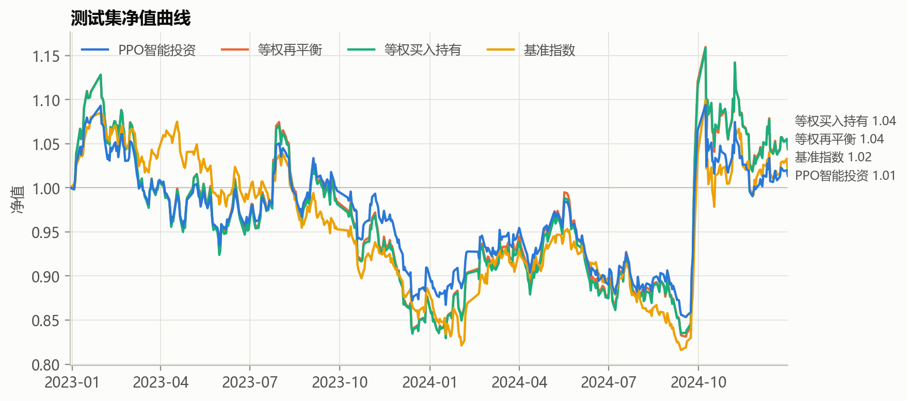

# 示例：4 只股票的量价 + 舆情数据

## 数据使用说明（请先阅读）

- **为什么只提供部分股票**：论文实证使用的全量数据是 3699 只 A 股、2014–2025 年的日线量价与新闻舆情，来自米筐
  RQData 的付费数据服务，费用约 **14 万元/年**，无法随仓库公开。本目录只提供部分股票的示例数据，用来演示从数据
  到训练、回测的完整流程。
- **只公开截至 2024-12-31 的历史数据**：数据授权只允许公开发布 2024 年及以前的历史数据，公开更新的数据属于违规。
  本目录的所有文件都截至 2024-12-31。**请勿把 2025 年及以后的数据加入本仓库，也不要转发。**
- **不提供原始数据**：日线行情、米筐个股新闻、日度情绪指数等原始数据与下面的训练数据集重复，且受数据授权限制，
  不放入仓库，只在下文说明其内容。
- **数据需要自行购买**：如需更多股票、更长的区间或 2025 年以后的数据，请自行购买米筐 RQData 的数据授权。
- **仓库不包含任何账号或密码**：从米筐重新取数需要使用你自己购买的账号，账号写在本地的
  `configs/local_rqdata.yaml`（已被 `.gitignore` 忽略，不会提交）。
- 数据版权归数据提供方所有，仅供学术研究复现本项目使用。

由于模型训练运行较慢（模型约 148 万参数；按论文规模的 10 只股票、20 万步训练，在 RTX 4090 笔记本 GPU 上单组
约需 45 分钟，消融和多随机种子实验需要几十组，CPU 上更慢），示例只使用**少量股票**和**较少的训练轮数**
（15 个 epoch）。这里的结果只用于说明程序可以正常运行，**不代表论文的实证结论**。

## 示例包含的股票

| 代码 | 名称 | 行业 | 新闻数（去重后） |
|---|---|---|---|
| 600519.XSHG | 贵州茅台 | 白酒 | 81,416 |
| 000858.XSHE | 五粮液 | 白酒 | 36,032 |
| 600036.XSHG | 招商银行 | 银行 | 73,177 |
| 601318.XSHG | 中国平安 | 保险 | 46,438 |

- **样本期**：2017-01-03 ~ 2024-12-31，米筐新闻数据从 2017 年开始。扣除 MA120 等指标的预热期后：
  训练 2017.07–2021（1087 天）、验证 2022（242 天）、测试 2023–2024（484 天）。
- **量价**：米筐 RQData 前复权日线，含开高低收、成交量、成交额、换手率、涨跌停价；基准为沪深300。
- **舆情**：米筐个股新闻 238,192 条，去重后 237,063 条。每条新闻带公司情绪的正面、负面权重，按与公司的相关度
  加权，聚合为个股日度情绪指数，取值 [−1, 1]，共 7,766 条。新闻标题另用金融情感词典打分，作为第二个情绪特征。

## 目录内容

| 路径 | 内容 |
|---|---|
| `data/raw/instruments.csv` | 股票列表 |
| `data/processed/rq4.npz` | **训练用数据集**：29 个特征（已用训练集统计量标准化）、收盘价、可买/可卖掩码、沪深300、日期与划分 |
| `data/summary/` | 表 1 舆情分布统计、图 1 新闻示例（30 条） |
| `results/` | 本次训练与回测的结果：指标表、净值、每日持仓、图表、训练日志、表 3、表 4 |
| `config.yaml` | 使用本目录数据的配置 |

`rq4.npz` 由上述原始数据经第 3、4 步生成。原始数据（不在仓库中）包括：前复权日线行情（开高低收、成交量、成交额、
涨跌停价、换手率），米筐个股新闻（标题、发布时间、来源、新闻与公司的情绪标签和权重、公司相关度），由新闻聚合的个股
日度情绪指数，沪深300 收盘价与交易日历，格式与第 1 步（`01_fetch_market.py`）的输出相同。

`rq4.npz` 与 `results/` 由早期版本的代码生成，29 个特征比当前的 25 维多出 MACD（DIF、DEA、柱）、MTM、新浪标题
情绪与新闻条数，少了 CNS、CDIV。当前代码可以直接用它训练和回测，模型按 29 维输入自动调整；如需与论文一致的
25 维数据集，请用自己的米筐数据重新运行第 1~4 步。

## 运行

**直接用训练数据集训练和回测**（不需要米筐账号）：

```bash
python scripts/05_train.py    --config examples/rq4/config.yaml --epochs 15
python scripts/06_backtest.py --config examples/rq4/config.yaml
```

结果保存在 `examples/rq4/outputs/`，不提交。

**用自己购买的米筐账号重新取数**：在 `configs/local_rqdata.yaml` 中写 `base: rq_sample.yaml`，再加上
`rqdata.username` 和 `rqdata.password`，然后依次运行：

```bash
python scripts/01_fetch_market.py    --config configs/local_rqdata.yaml   # 只取上述 4 只股票，含米筐新闻
python scripts/03_build_sentiment.py --config configs/local_rqdata.yaml   # 新闻已在第 1 步取得，不需要第 2 步
python scripts/04_build_dataset.py   --config configs/local_rqdata.yaml
python scripts/05_train.py           --config configs/local_rqdata.yaml --epochs 15
python scripts/06_backtest.py        --config configs/local_rqdata.yaml
```

## 结果

训练 15 个 epoch，即 15 × 1068 = 16,020 步，在 RTX 4090 笔记本 GPU 上用时约 1.5 分钟。模型参数 1,482,123 个：
与表 3 的结构相同，只是输出维度从 11 变为 5（4 只股票 + 现金）。回测使用按验证集夏普比率选出的模型 `best.pt`。

| | PPO | 等权再平衡 | 等权买入持有 | 沪深300 |
|---|---|---|---|---|
| **验证集 2022** 年化收益 | −9.1% | −13.3% | −14.0% | −22.4% |
| 夏普比率 | −0.43 | −0.50 | −0.53 | −1.15 |
| 最大回撤 | 28.6% | 35.7% | 36.0% | 29.0% |
| **测试集 2023–2024** 年化收益 | 0.7% | 2.3% | 2.3% | 0.9% |
| 夏普比率 | −0.02 | 0.05 | 0.06 | −0.01 |
| 最大回撤 | 21.9% | 26.3% | 26.5% | 24.8% |
| 年化波动 | 17.6% | 23.0% | 22.8% | 17.9% |
| 累计交易成本 | 2.0% | 0.7% | 0.2% | — |



- 测试集上 PPO 平均持有约 20% 现金，波动和最大回撤低于等权组合，但收益略低，交易成本也更高。
- 验证集用于选模型，其表现有选择偏差，不能作为样本外证据。
- 只有 4 只股票、单个随机种子、15 个 epoch，结果的统计意义有限。论文结论应以全量数据、多随机种子的实验为准。
