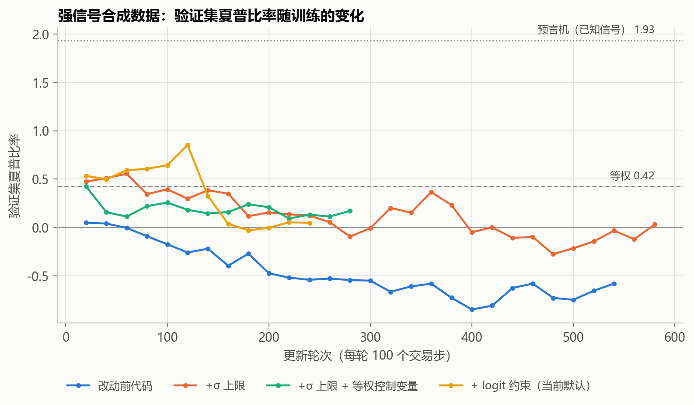

# 训练可学习性检验（合成数据）

用一份**信号已知**的合成数据检验整条训练流程能否学到信号。真实市场里的信号强度未知，回测好坏无法
区分是"模型学到了东西"还是"运气"。合成数据里信号强度可控，预言机（直接按已知信号配置）给出可学习收益
的上限，因此可以判断：训练是否在学习、学到了多少、哪些设置在起作用。

## 文件

| 文件 | 作用 |
|---|---|
| `make_synthetic.py` | 生成合成数据，格式与步骤 1、2 的输出相同，后面直接接步骤 3~6 |
| `oracle.py` | 预言机基准：按已知信号倾斜配置 w ∝ exp(k·s) |
| `exact_gradient.py` | 精确梯度诊断：不经过强化学习，用"一步超额收益"直接训练同一网络 |
| `compare.py` | 汇总多组实验：测试集指标、持仓与真实信号的秩相关、训练诊断 |
| `plot_results.py` | 绘制 `results/val_sharpe_strong_signal.png` |
| `configs/` | 基础配置 `synthetic.yaml`，以及每个变体一个只写差异的配置 |
| `results/` | 本次检验的结果（见下文） |

合成数据的设定：12 只股票，情绪 s_t = tanh(z_t)，z_t 为持续性 0.97 的 AR(1) 过程，次日收益中含
α·s_t 的可预测部分。新闻标题是 s_t 的带噪观测，米筐情绪指数直接取 s_t。强信号 α=0.003，弱信号 α=0.0008。

## 运行

```bash
C=experiments/sanity_check/configs
python experiments/sanity_check/make_synthetic.py --config $C/synthetic.yaml          # 强信号；弱信号加 --alpha 0.0008
python scripts/03_build_sentiment.py --config $C/synthetic.yaml
python scripts/04_build_dataset.py   --config $C/synthetic.yaml
python experiments/sanity_check/oracle.py --config $C/synthetic.yaml

# 当前默认设置与各变体（共用同一数据集，用 --tag 区分输出目录 outputs_synthetic/u10_<tag>/）
python scripts/05_train.py --config $C/synthetic.yaml --tag default && python scripts/06_backtest.py --config $C/synthetic.yaml --tag default
for v in no_logit_l2 global_head shared_head behavior_clip rf_baseline weight_decay; do
  python scripts/05_train.py --config $C/v_$v.yaml --tag $v && python scripts/06_backtest.py --config $C/v_$v.yaml --tag $v
done

python experiments/sanity_check/compare.py --config $C/synthetic.yaml \
    --runs 默认=outputs_synthetic/u10_default 无logit约束=outputs_synthetic/u10_no_logit_l2
python experiments/sanity_check/exact_gradient.py --config $C/synthetic.yaml --override '{"logit_l2": 0}'
```

改动前代码的对照：`git worktree add ../rl_invest_v0 8a8525c`，把 `configs/v0_baseline.yaml` 复制到
`../rl_invest_v0/configs/`，在该目录下用它运行步骤 3~6。

每组 60,000 步在 RTX 4090 笔记本 GPU 上单独运行约 10 分钟，多组并行会明显变慢。

## 结果

以下都是**单个随机种子**的结果，用于诊断训练流程，不能当作模型效果的证据。

### 1. 预言机上限（`oracle_*.csv`）

| 数据 | 测试集等权年化 / 夏普 | 预言机 k=1 年化 / 夏普 | 验证集等权夏普 | 验证集预言机夏普 |
|---|---|---|---|---|
| 弱信号 α=0.0008 | 19.6% / 0.91 | 20.2% / 0.90 | 0.40 | 0.61 |
| 强信号 α=0.003 | 24.2% / 1.14 | 62.3% / 2.87 | 0.42 | 1.93 |

弱信号的预言机只比等权高约 0.6%，换手成本就能抵消，所以弱信号实验里的收益差异没有意义，只看训练诊断。

### 2. 训练过程（`runs.csv`、`val_sharpe_curves.csv`、`*_signal_test.csv`）



- **改动前的代码学不到信号。** 强信号下验证集夏普从 0.05 一路降到 −0.85。最优模型是第 20 轮更新的初始策略，
  测试集持仓与信号的秩相关为 −0.05。弱信号下价值损失约 1.27，是新代码的 10 倍以上。
- **加了 σ 上限、但没有 logit 约束的新代码**：验证集夏普峰值约 0.56，然后回落；测试集秩相关 0.12。
- **加了 logit 约束（当前默认）**：验证集夏普峰值 0.85，是各组最高，但第 140 轮更新后回落到 0 附近。
  这一组只跑了 26,000 步就手动停止。
- **所有组都会在训练后期退化**，说明模型会过拟合训练期。必须按验证集选模型（`best.pt`），并用多个随机种子
  报告结果。

### 3. 精确梯度诊断（`exact_gradient.csv`）

同一网络不经过强化学习，直接以一步超额收益为目标训练：

| 设置 | 第 500 次迭代的验证集秩相关 | 第 1000 次 | 第 1000 次 μ 的饱和比例 |
|---|---|---|---|
| 逐标的策略头，无 logit 约束 | −0.10 | −0.10 | 100% |
| 共享评估器，无 logit 约束 | 崩溃（第 250 次时为 +0.49） | 崩溃 | μ 全部趋于 0，归一化得到 NaN |
| 逐标的策略头 + logit 约束 0.01（当前默认） | +0.60 | +0.25 | 66% |
| 逐标的策略头 + logit 约束 0.2 | +0.22 | +0.15 | 0% |

完整数据（含 0.05 的约束强度、共享评估器带标的编码等）见 `results/exact_gradient.csv`。

- sigmoid 饱和是网络学不到信号的主要原因：没有约束时 250 步内 μ 全部变成 0 或 1，梯度消失、输出冻结。
- 加约束后能学到信号，但继续训练时，训练集目标值持续上升，验证集秩相关反而下降，这是过拟合。

### 4. NaN 崩溃现场

在以更新前策略 π_k 为裁剪中心的设置下，某个批次中：
- 缓存区旧样本在 π_k 下的 log 概率低至 −518.7；
- 参数更新后 log 概率比达到 192.5，ρ 溢出为 inf；
- 该样本的重要性权重 π_k/π_b 下溢为 0，0 × inf = NaN，梯度从策略头一直传到 LSTM。

修复方法：log 概率比截断到 [−20, 20]。用这一批数据复算，修复前损失为 NaN，修复后为 0.045。

### 注意事项

- 改动前的代码用全样本期的新闻数选股，投资域与新代码不同，所以两者的等权基准数值不一样。比较时请看
  各自相对等权的差异。
- 强信号下的 A 组在 54,000 步时因 CUDA 非法内存访问中断。当时同一块显卡上有 5 个进程，回测使用的是
  中断前保存的最优模型。
- E、F、G、H、I 组为了腾出显卡被手动停止（16,000~29,000 步），只用于观察验证集曲线，没有测试集结果。
